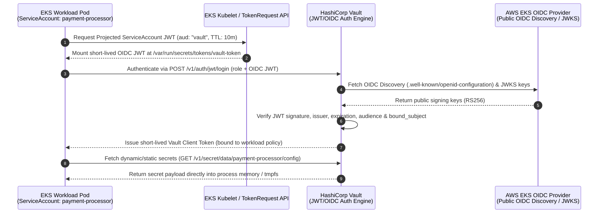

# Secretless Workload Authentication with HashiCorp Vault, AWS EKS & OIDC

[](https://www.terraform.io/)
[](https://aws.amazon.com/eks/)
[](https://www.vaultproject.io/)
[](https://openid.net/connect/)

A production-ready reference architecture and working implementation of **Secretless Workload Authentication** on **AWS EKS** using **OpenID Connect (OIDC)** and **HashiCorp Vault**.

This project eliminates static credentials, hardcoded API keys, and native Kubernetes `Secret` objects (`etcd` secret sprawl) by leveraging cryptographically signed, short-lived OIDC JSON Web Tokens (JWTs) issued by the AWS EKS OIDC Provider.

---

## Architecture Overview



### Key Security Principles
1. **Zero Static Credentials**: No long-lived AWS IAM keys, Vault tokens, or database passwords stored in Git, CI/CD, or Kubernetes `Secret` resources.
2. **Short-Lived Projected Tokens**: Uses the Kubernetes `TokenRequest` API to project ephemeral, audience-bound (`aud: vault`) OIDC tokens that automatically rotate.
3. **Cryptographic OIDC Verification**: HashiCorp Vault validates workload tokens directly against the AWS EKS public OIDC Discovery endpoint (`/.well-known/openid-configuration`).
4. **Dual Consumption Patterns Included**:
   - **Pattern A (Vault Agent Sidecar Injector)**: Transparently authenticates via OIDC and renders secrets into an in-memory `tmpfs` volume (`/vault/secrets/`).
   - **Pattern B (Direct SDK / In-Memory Retrieval)**: The Python application reads the projected OIDC token and exchanges it with Vault directly in memory—never writing secrets to any filesystem.

---

## Repository Structure

```text
secretless-workload-authentication/
├── .github/
│   └── workflows/
│       └── ci.yml                          # Secretless GitHub Actions CI (GitHub OIDC -> AWS)
├── app/
│   ├── Dockerfile                          # Hardened, non-root Python container
│   ├── main.py                             # Workload demonstrating SDK & tmpfs secret retrieval
│   └── requirements.txt                    # Python dependencies (hvac, fastapi, uvicorn)
├── k8s/
│   ├── 01-namespace.yaml                   # Isolated application namespace (app-ns)
│   ├── 02-serviceaccount.yaml              # Workload ServiceAccount with OIDC annotations
│   ├── 03-deployment-vault-agent.yaml      # Pattern A: Vault Agent Injector (tmpfs memory mount)
│   ├── 04-deployment-sdk-jwt.yaml          # Pattern B: Direct OIDC Projected Token (in-memory)
│   └── 05-network-policy.yaml              # Zero-trust NetworkPolicy restricting pod egress
├── scripts/
│   ├── setup-vault-oidc.sh                 # Automated CLI script to configure Vault OIDC & policies
│   └── verify-secretless.sh                # Auditing script to verify zero K8s Secrets & JWT claims
├── terraform/
│   ├── versions.tf                         # Terraform & provider version constraints
│   ├── variables.tf                        # Configurable infrastructure & Vault parameters
│   ├── vpc.tf                              # VPC, public/private subnets, NAT gateways
│   ├── eks.tf                              # EKS Cluster + OIDC Provider + Managed Node Group
│   ├── iam_irsa.tf                         # AWS IRSA for Vault KMS Auto-Unseal & AWS Auth
│   ├── vault_helm.tf                       # HashiCorp Vault Helm deployment on EKS
│   ├── vault_oidc_config.tf                # Vault JWT/OIDC backend, policies, roles & sample secrets
│   ├── outputs.tf                          # Cluster, OIDC, and Vault outputs
│   └── terraform.tfvars.example            # Sample variable file
├── .gitignore
├── LICENSE
└── README.md
```

---

## Prerequisites

- **AWS CLI** v2 configured with administrative permissions
- **Terraform** >= 1.6.0
- **kubectl** >= 1.28
- **Helm** >= 3.12
- **Vault CLI** >= 1.15 (optional, for running helper scripts)
- **jq** (for shell script JSON parsing)

---

## Quick Start Guide

### Step 1: Provision AWS EKS, OIDC Provider & Vault via Terraform

```bash
cd terraform
cp terraform.tfvars.example terraform.tfvars

# Initialize and apply stage 1 (VPC, EKS Cluster, OIDC Provider, Vault Helm Release)
terraform init
terraform apply -target=module.vpc -target=module.eks -target=helm_release.vault -auto-approve

# Update local kubeconfig
aws eks update-kubeconfig --region $(terraform output -raw aws_region) --name $(terraform output -raw cluster_name)
```

### Step 2: Configure Vault OIDC Auth & Seed Sample Secrets

You can configure Vault either via **Terraform** (full apply) or using the standalone script:

**Option A — Via Terraform:**
```bash
# Port-forward Vault in background if using cluster-internal service
kubectl port-forward svc/vault -n vault 8200:8200 &
export VAULT_ADDR="http://127.0.0.1:8200"
export VAULT_TOKEN="root" # Or initial root token if running in HA mode

terraform apply -auto-approve
```

**Option B — Via Standalone Setup Script:**
```bash
chmod +x scripts/setup-vault-oidc.sh
./scripts/setup-vault-oidc.sh
```

### Step 3: Deploy the Secretless Workloads to EKS

```bash
kubectl apply -f k8s/01-namespace.yaml
kubectl apply -f k8s/02-serviceaccount.yaml
kubectl apply -f k8s/03-deployment-vault-agent.yaml
kubectl apply -f k8s/04-deployment-sdk-jwt.yaml
kubectl apply -f k8s/05-network-policy.yaml
```

### Step 4: Verify Secretless Authentication

Run the verification script to inspect the OIDC JWT claims, verify zero Kubernetes `Secret` objects exist in `app-ns`, and confirm the application fetched secrets from Vault:

```bash
chmod +x scripts/verify-secretless.sh
./scripts/verify-secretless.sh
```

---

## Deep Dive: How OIDC Binding Works

When the `payment-processor` pod starts, Kubernetes mounts a projected JWT token at `/var/run/secrets/tokens/vault-token`:

```json
{
  "aud": ["vault"],
  "exp": 1735689600,
  "iat": 1735689000,
  "iss": "https://oidc.eks.us-east-1.amazonaws.com/id/EXAMPLED539D4633E53DE1B716D3041E",
  "kubernetes.io": {
    "namespace": "app-ns",
    "pod": {
      "name": "payment-processor-sdk-6b8f9c7d4-x9z2k",
      "uid": "a1b2c3d4-e5f6-7890-abcd-ef1234567890"
    },
    "serviceaccount": {
      "name": "payment-processor",
      "uid": "f0e9d8c7-b6a5-4321-fedc-ba0987654321"
    }
  },
  "nbf": 1735689000,
  "sub": "system:serviceaccount:app-ns:payment-processor"
}
```

Vault's `jwt` auth role (`payment-processor`) enforces strict cryptographic claims validation:
- **`oidc_discovery_url`**: Matches the exact EKS cluster OIDC issuer URL.
- **`bound_audiences`**: Must equal `["vault"]`.
- **`bound_subject`**: Must equal `"system:serviceaccount:app-ns:payment-processor"`.
- **`token_ttl`**: Short-lived Vault token (e.g., `15m`).

---

## Cleanup

To tear down all AWS and Kubernetes resources cleanly:

```bash
kubectl delete -f k8s/ --ignore-not-found
cd terraform
terraform destroy -auto-approve
```

---

## License

Released under the [MIT License](LICENSE).
